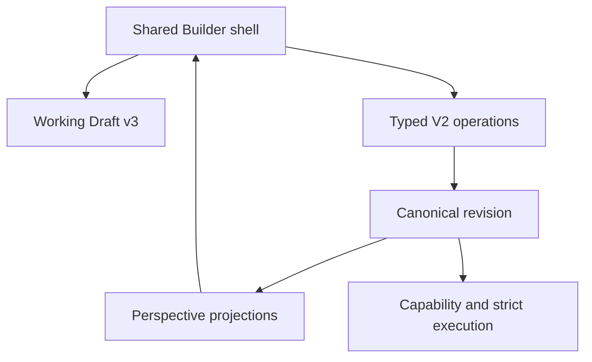
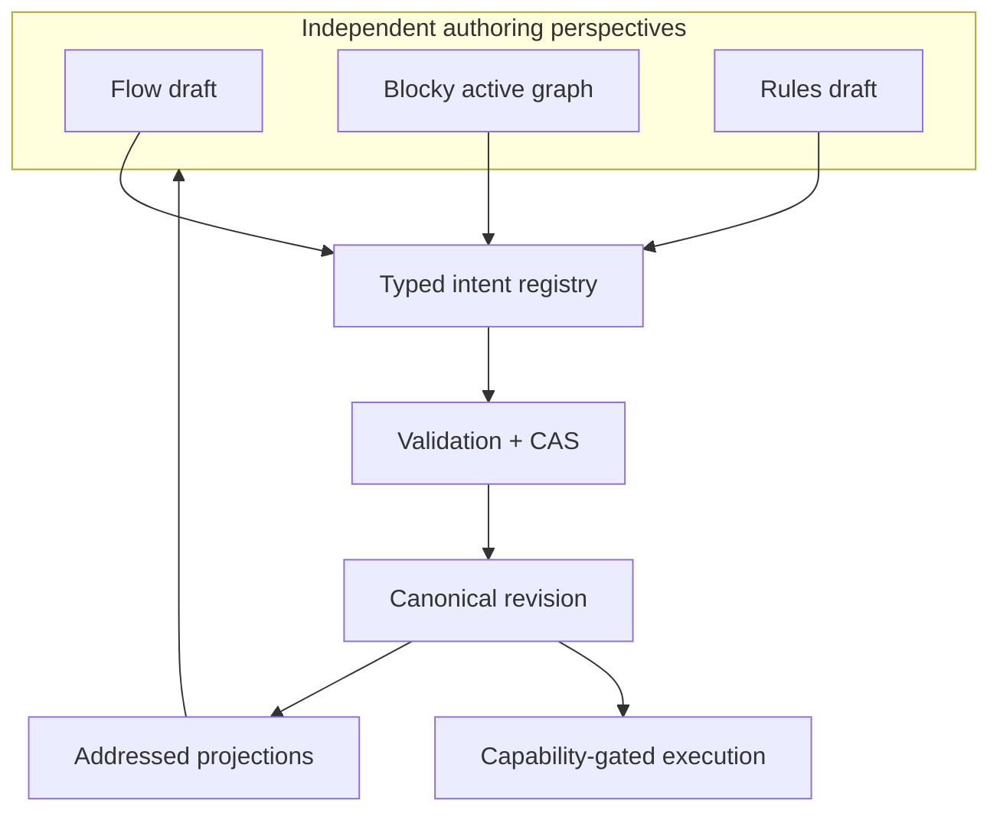

# Architecture gap analysis

Audited commit: `5ceaeda56bbe5012bf755d28c580dc848814492c`. Machine-readable findings: [architecture-gap-analysis.json](architecture-gap-analysis.json).

## Current architecture

The central architecture is sound: one Canonical authority, independent visual draft, CAS operations, derived perspectives and downstream execution. No evidence justifies a new semantic engine or Builder.

## Target contract

## Prioritized findings

| Priority | Finding / root cause | Risk | Correction and evidence gate |
|---|---|---|---|
| P0 | No active corruption path was verified | preserve this invariant | keep source-hash CAS, complete-candidate validation and strict lowerer mandatory |
| P1 | Flow edit markers exceed independently proven Flow draft transactions | misleading/broken authoring | add a FlowDraft→capital intent adapter; prove RT-A/C/D and N4 |
| P1 | Blocky grammar breadth exceeds active-graph compiler breadth | visual draft mistaken for semantic support | publish per-block compiler capability; retain unsupported draft exactly |
| P1 | Rules is addressed Inspector editing, not a complete independent Rules compiler | cross-view expectations | gate controls to registered operations; add Rules round trips |
| P1 | Working Draft is browser-local | disconnected work can be lost across device/storage clearing | optional server draft record, explicitly noncanonical |
| P2 | perspective capability defaults are partly static | backend support can be overstated | join manifests with backend capability evidence |
| P2 | client JSON identity and backend semantic hash can be confused | stale/conflict diagnostics | name/display them separately; CAS only with backend hash |
| P2 | draft-only grammar lacks uniform execution badges | false executable expectation | explicit draft-only status and no semantic commit action |
| P3 | selection/Inspector restoration is best effort | navigation friction | stable-address restoration where target survives |

## Implementation roadmap

1. Freeze new UI grammar until operation and perspective registries are CI-enforced.
2. Close P1 Flow and Blocky compilers one corpus case at a time; never promote by projection alone.
3. Add Rules gesture-to-operation tests and server-optional draft recovery.
4. Bind capability manifests to backend evidence and improve diagnostics.
5. Address P3 layout only after semantic round trips are green.

## CI migration recommendations

- Static: validate JSON schemas, exact 44-operation registry coverage and source references.
- Unit: one test per operation precondition, address impact and stale-hash failure.
- Perspective: corpus-driven projection identity and gesture→operation round trips.
- Persistence: Canonical and Working Draft save/reopen tested independently.
- Execution: retain generated C#, core, weighted/composable and temporal/replay Docker matrices.
- API: retain persisted V2 Revision→Run→Evidence Docker journey.
- Browser: keep real Chrome draft isolation/drag tests; add live-backend browser proof only when provisioned and label fixture-backed tests honestly.

Known unknowns are full Flow semantic editing coverage, server-backed disconnected drafts, complete Rules authoring, arbitrary state-graph lowering, and executable contracts for fixed-money, signals, loops and functions.
