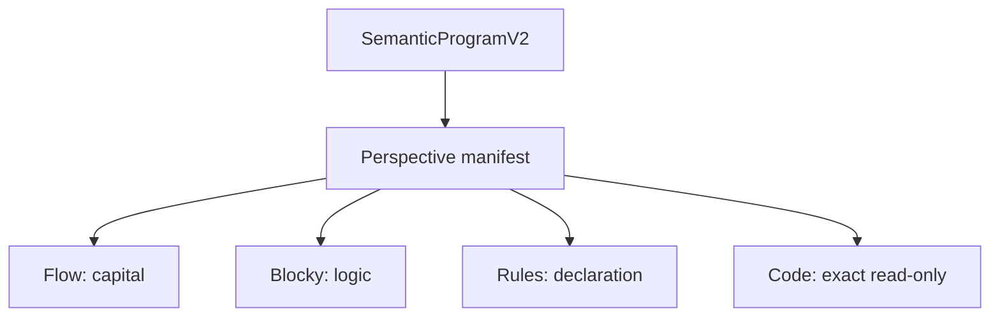
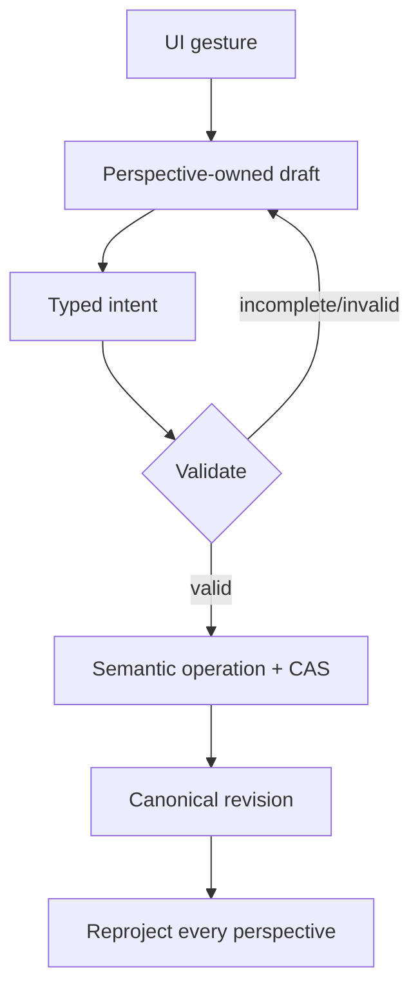

# Bidirectional perspective contract

Audited commit: `5ceaeda56bbe5012bf755d28c580dc848814492c`. Structured contract: [bidirectional-perspective-contract.json](bidirectional-perspective-contract.json).

## Forward projection

Every UI element carries a stable source semantic address where one exists. Hidden fields remain in Canonical and survive reprojection. Unsupported meaning is shown read-only or diagnosed; projections must not fabricate executable nodes. A Group definition alone creates neither a Blockly block nor a Flow capital node.

## Reverse authoring

The commit boundary is the successful typed operation, not block creation, field focus, or drag. Failure retains both the draft and prior Canonical. A stale hash is rejected rather than merged heuristically.

### Perspective isolation

- Flow geometry never changes Canonical; a Flow semantic gesture does not create a Blockly draft.
- Blockly geometry/connections remain native workspace state; a block becomes eligible for commit only through an active, complete, typed graph.
- Rules edits emit operations and never patch Blockly serialization.
- Object creation commits a definition only. Reference insertion is a separate gesture.
- Inspector is an adapter for the selected semantic/draft address, not a model owner.
- switching Structure/Add/Objects or perspectives preserves compatible viewport, disconnected drafts and semantic identity.

## Equivalence

Flow “QQQ target 100%, monthly,” Rules “rebalance QQQ to 100% monthly,” and a Blocky monthly target-allocation graph are exact equivalents only if target kind, weight, allocation method, clock boundary, cash remainder and unknown policies match. Missing policy fields make translation partial/read-only.

“Buy QQQ for $100 monthly” is not equivalent: it consumes cash by amount and currently remains draft-only. Translation classifications are exact, partial/lossless read-only, draft-only, unsupported, or invalid.

Save/reopen restores Canonical from the Revision and visual draft from Working Draft v3 independently. Undo/redo is native within the visual draft; committed semantic undo is an explicit inverse/new revision, not a replay of Blockly history.
