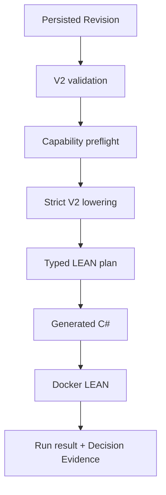

# Execution mapping

Audited commit: `5ceaeda56bbe5012bf755d28c580dc848814492c`. Structured evidence: [execution-mapping.json](execution-mapping.json).

Authoring validity, semantic validity, execution completeness/support, provider availability and runtime availability are independent. Representable does not imply reference-evaluable; reference-evaluable does not imply lowerable; compilation does not imply Docker differential; browser visibility implies none of them.

| Semantic family | Reference | Lowerer/C# | Docker | Persisted API | Browser |
|---|---:|---:|---:|---:|---:|
| Direct fixed target/rebalance | yes | yes | verified | verified | Run/result/evidence verified |
| Filter/rank/Top N/fallback | yes | yes | verified | verified | projection and result; authoring partial |
| Weighted Score/proportional allocation | yes | yes | verified | verified | projection only |
| Parallel sleeves and conditional allocation | yes | yes | verified | verified | projection/partial edit |
| Event/State/Memory and replay | yes | yes | verified | verified | projection/partial Inspector |
| Weekly completed context → daily action | yes | yes | verified | verified | projection only |
| Nested AssetSet/random/set operations | yes | maintained subset | corpus profiles | gated | draft/projection partial |
| Fixed-money/quantity Buy/Sell | no Canonical statement | no | no | no | draft-only |
| Signals, loops, functions | no executable Canonical contract | no | no | no | draft-only |

Strict lowering remains unchanged: unsupported nodes yield capability/typed execution failure and are never padded or simplified. Missing data remains Unknown with explicit history/provider requirements; clock boundaries are completed-only; ranking/ties and seeded random profiles are deterministic; temporal profiles carry checkpoint/replay evidence.

Evidence is separated into static schema tests, unit/reference tests, generated compilation, maintained Docker differentials, persisted API Docker integration and real-Chrome UI interaction. `scripts/check_builder_browser.mjs` uses deterministic HTTP fixtures; `scripts/run_persisted_v2_api_lean_e2e.py` independently proves actual Docker persistence. The browser test must not be described as a live Docker browser test.
