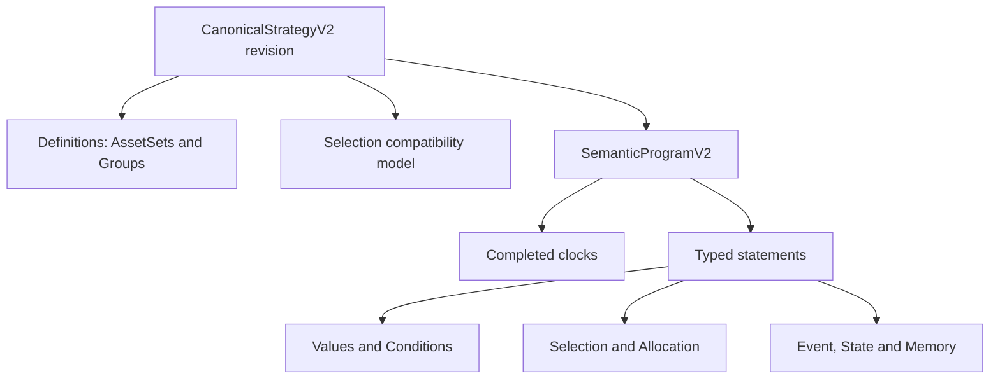

# Semantic model map

Audited commit: `5ceaeda56bbe5012bf755d28c580dc848814492c`. Machine-readable inventory: [semantic-model-map.json](semantic-model-map.json).

## Root and identity

`CanonicalStrategyV2` (`models.py`) contains metadata, definitions, operator lock, optional compatibility `selection`/`predicate`, and the authoritative `SemanticProgramV2`. Semantic IDs identify addressable definitions, expressions and statements across projections. The whole immutable document is persisted in a Revision; `source_hash` provides concurrency/provenance identity.

`SemanticProgramV2` contains completed-only clocks, initial state, formalization provenance and ordered typed statements. Program order is semantic; screen position is not.

## Typed inventory

| Family | Actual schema and meaning | Inputs → output | Important validation/timing |
|---|---|---|---|
| AssetSet/Group | `AssetSetDefinitionV2`; `GroupDefinitionV2` references an AssetSet | symbols → reusable candidate domain | unique normalized symbols; stable ID; no capital meaning |
| Selection | `SelectionV2`, `SelectionStatementV2` | domain, eligibility, ranking, count, shortage/fallback → evaluated subgroup | count bounds, typed candidate context, deterministic ranking/ties |
| Scalar values | literal, daily price/return, cross-sectional aggregate, event/clock/state-relative values | typed observations/context → decimal + `SemanticType` | quantity/unit/clock compatibility, history requirements, unknown propagation |
| Cross-sectional values | rank/percentile/quantile/bucket/min-max/z-score; weighted Score | candidate-domain values → per-member value | named domain, bins where required, missing/normalization policy |
| Conditions | comparison, ALL/ANY, NOT, N-of-M, state equality, event window | typed values/truth → T/F/U | operand compatibility; explicit unknown semantics |
| Clock/Event | `ProgramClockV2`, `EventDefinitionV2` | timeframe/boundary/trigger → completed occurrence | close boundary; `completed_only=true`; occurrence policy |
| State/Memory | transition and remember statements; remembered/time-since values | event/condition/value → durable keyed state/value | declared key/type; deterministic order and checkpoint/replay |
| Allocation | target, leg, allocation statement, guarded allocation, override | asset/group/selection/cash/retain + policy → desired target exposure | target weights and internal policy are explicit; allocation is not selection |
| Control | conditional statement | condition + then/otherwise statements → ordered behavior | explicit unknown policy; fallback here is not shortage fallback |
| Unresolved | unresolved statement + formalization provenance | source phrase → nonexecutable preserved intent | never silently lowered |

## Required distinctions

- **Asset vs AssetSet:** one symbol versus a candidate domain.
- **Group vs Subgroup:** static reusable definition versus dynamically evaluated Selection output.
- **Selection vs Allocation:** who qualifies/is chosen versus where capital goes.
- **Investment vs Rebalance:** external cash/quantity action is not a target-weight adjustment. Current Canonical supports the maintained allocation/rebalance model; fixed-money/quantity Buy/Sell remains Working Draft only.
- **Contribution vs exposure:** recurring contribution assumptions belong to Run/execution configuration unless Canonical semantics are explicitly added.
- **Event, State, Memory:** occurrence, durable mode and remembered typed observation are separate identities.
- **Evaluation vs execution clocks:** observing a completed weekly value does not itself schedule a daily allocation.
- **Portfolio split vs sequence:** parallel ownership weights differ from sequential statements.

Serialization is Pydantic JSON for Canonical and native Blockly JSON for visual drafts. The latter is never a substitute for the former.
